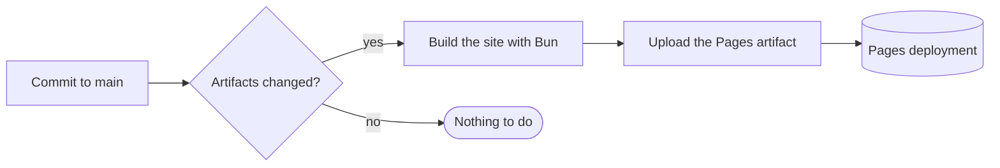
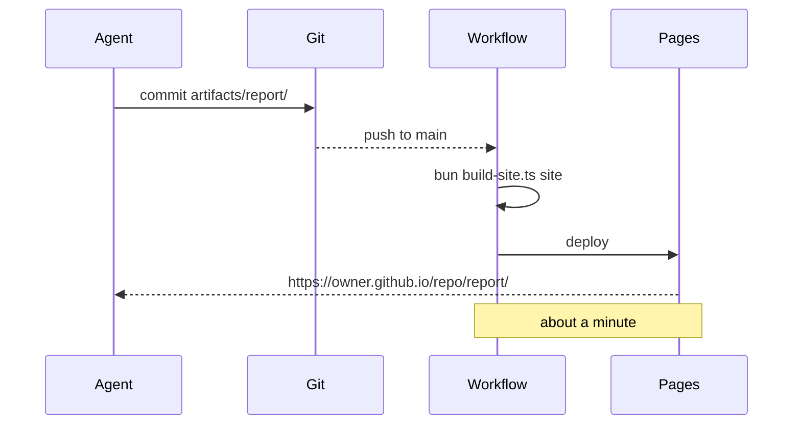
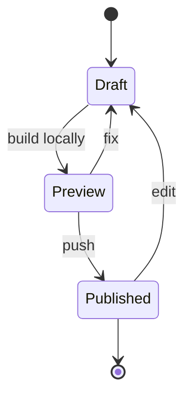
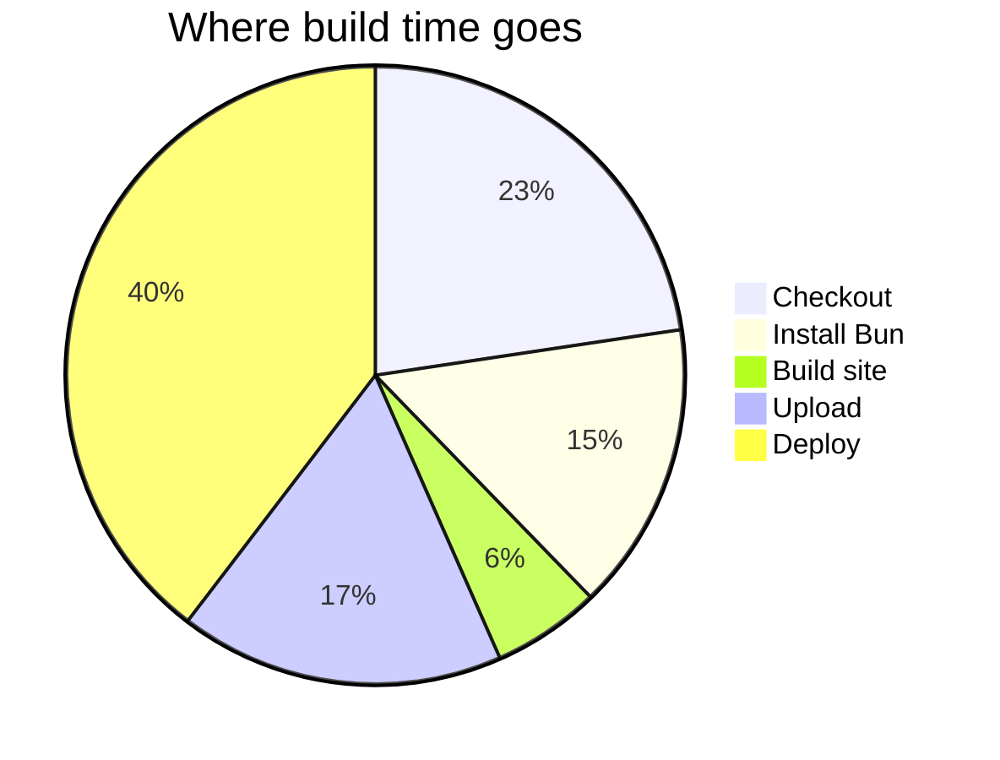
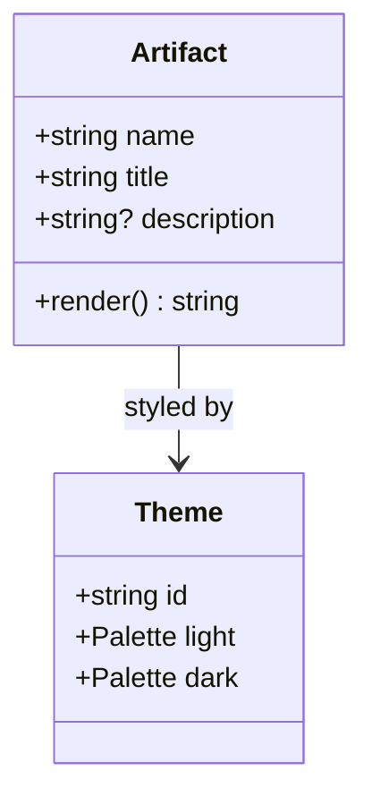
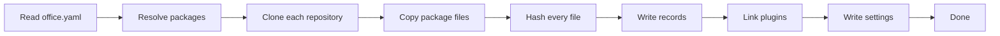
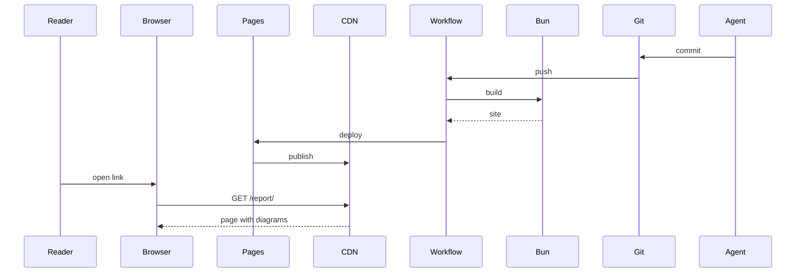

# Diagram gallery

How a publish travels from a commit to the Pages site, drawn as Mermaid diagrams that follow the reader's theme.

## Flowchart

## Sequence

## State

## Pie

## Class

## A wide one

## A wide sequence

